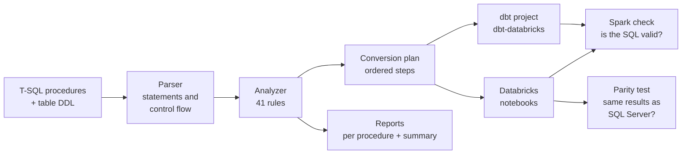

# sproc-to-lakehouse

**Moves SQL Server stored procedures to Databricks, and is explicit about what it could not
move.**

Many healthcare and pharma data teams still run core business logic as SQL Server stored
procedures: daily dispense summaries, claim classification, inventory snapshots,
enrollment upserts. Moving them to Databricks is usually a manual rewrite, or a SQL
translator whose output looks right but behaves differently in subtle ways. This tool
reads each procedure, decides what can be converted safely, writes the Databricks code
(a dbt project and Databricks notebooks), lists everything a person still has to decide,
and then runs the original and the converted code on the same data to check the results
match.

> All procedures, tables and data in this repository are **synthetic**: a fictional
> specialty pharmacy. No real company, product, payer, prescriber or patient is
> represented.

## Results

The tool converted 12 synthetic stored procedures written to cover the T-SQL a real
estate contains: CTEs, temp tables, MERGE, window functions, date logic, CASE-heavy
business rules, a cursor, dynamic SQL and TRY/CATCH with transactions.

| | Result |
|---|---|
| Converted completely | **6 of 12** procedures (no manual steps) |
| Converted partly | 6 of 12, with **9 manual steps** marked, each with the reason and the original T-SQL |
| Same results as SQL Server | **6 of 6** fully converted procedures match on every compared column |
| Same check with the tool's targeted fixes switched off | 2 of 6 match; the other 4 fail on Spark |
| Generated SQL valid on Apache Spark | 19 of 19 converted notebook steps, 10 of 10 dbt model builds |
| Automated tests | 294 passing, plus 2 end-to-end parity tests (SQL Server + Spark) |

How these were measured:

- **Same results** means: the original procedure ran on Microsoft SQL Server 2022 (CU27)
  and the generated notebook code on Apache Spark 4.0.1 with Delta Lake 4.0.0, each
  against the same 3,576 rows of seeded synthetic data. The tables each procedure writes
  (and the result set it returns) were compared row by row. Every compared table was
  actually changed by its procedure, so a match is not an empty comparison, and a test
  confirms that a deliberately changed parameter is caught as a mismatch. Full report:
  [`docs/results/parity_report.md`](docs/results/parity_report.md).
- **Fixes switched off** reruns the same comparison with the generator's targeted
  rewrites disabled, which is close to running a plain SQL translator inside the same
  pipeline: [`docs/results/parity_report_without_fixes.md`](docs/results/parity_report_without_fixes.md).
- **Valid on Spark**: [`docs/results/spark_check.md`](docs/results/spark_check.md). Eight
  steps executed; eleven Delta-only statements (MERGE, UPDATE, DELETE) were parsed and
  resolved by Spark.

The six partly converted procedures are the ones a migration lead would expect to need a
person: a row-by-row cursor, dynamic SQL, a transaction with TRY/CATCH, a temp table
updated in several steps, `@@ROWCOUNT` logging and an unsupported string function. The
tool says so up front instead of producing code that only looks finished.

## How it works



1. **Parse.** Each procedure is split into statements and control-flow blocks, including
   legacy code written without semicolons.
2. **Analyze.** 41 rules label every construct: converts automatically, converts with a
   note worth reading, or needs a person. Each label comes with the reason.
3. **Plan and generate.** Convertible steps become Databricks SQL. The output is a dbt
   project and one notebook per procedure. Anything that needs a person becomes a marked
   manual step carrying the original T-SQL, and the generated code refuses to run past it.
4. **Report.** A Markdown and JSON report per procedure, plus a summary.
5. **Verify.** Generated SQL is checked on Apache Spark, and the original and generated
   code run side by side on SQL Server and Spark with Delta Lake.

Browse the generated output without installing anything:
[`examples/`](examples) holds the dbt project, the notebooks and the reports for all 12
procedures, starting with [`examples/reports/summary.md`](examples/reports/summary.md).

## What a plain SQL translation gets wrong

The tool uses [sqlglot](https://github.com/tobymao/sqlglot), an open-source SQL
translator, for individual statements. Translated as-is, these T-SQL idioms fail or
change meaning on Databricks. Each Spark behaviour below was reproduced on Apache Spark
4.0.1, and each SQL Server behaviour on SQL Server 2022.

| T-SQL | Plain translation on Databricks / Spark | What the tool does |
|---|---|---|
| `UPDATE t ... FROM t JOIN s` | syntax error: Databricks UPDATE has no FROM | rewrites to `MERGE INTO`, de-duplicating the source when safe |
| `TRY_CONVERT(DATE, s, 101)` | becomes `TO_DATE`, which fails on bad input instead of returning NULL | `CAST(TRY_TO_TIMESTAMP(s, 'M/d/yyyy') AS DATE)` |
| `'ID-' + CAST(n AS VARCHAR)` | `+` is numeric addition: type error | `CONCAT(...)` |
| `DATEPART(ISO_WEEK, d)` | `EXTRACT(WEEKISO ...)`: not a valid field | `EXTRACT(WEEK FROM d)` |
| `flag_bit = 1` | BIT arrives as BOOLEAN: BOOLEAN = INT is a type error | `flag_bit = TRUE` (uses the DDL) |
| `ISNULL(d, '19000101')` | `'19000101'` cannot be cast to DATE at run time | `CAST('1900-01-01' AS DATE)` (uses the DDL) |
| `TRUNCATE TABLE t` | not supported by open-source Delta Lake | `DELETE FROM t` |
| `STUFF(s, 4, 3, '***')` | passed through unchanged: function does not exist | flagged for a person |
| `DATEDIFF(DAY, '23:00', '01:00 next day')` | returns 0 on Spark, 1 on SQL Server | converted, with a review note |

## Before and after

From [`usp_build_monthly_inventory_snapshot`](samples/tsql/02_usp_build_monthly_inventory_snapshot.sql),
a step that back-fills a three-month rolling average. T-SQL updates through a join; Databricks
has no `UPDATE ... FROM`, so the tool rewrites it as a `MERGE` and resolves the procedure's
variables into parameters. This procedure matches SQL Server in the parity test.

T-SQL (original):

```sql
WITH trend AS (
    SELECT site_id, product_id, snapshot_month,
           AVG(dispensed_qty) OVER (
               PARTITION BY site_id, product_id
               ORDER BY snapshot_month
               ROWS BETWEEN 2 PRECEDING AND CURRENT ROW
           ) AS avg_dispensed_3m
    FROM dbo.inventory_snapshots
    WHERE snapshot_month BETWEEN EOMONTH(@snapshot_month, -2) AND @month_end
)
UPDATE s
SET s.avg_dispensed_3m = t.avg_dispensed_3m
FROM dbo.inventory_snapshots AS s
INNER JOIN trend AS t
    ON t.site_id = s.site_id
   AND t.product_id = s.product_id
   AND t.snapshot_month = s.snapshot_month
WHERE s.snapshot_month = @month_end;
```

Databricks notebook (generated, from
[`examples/notebooks`](examples/notebooks/usp_build_monthly_inventory_snapshot.py)):

```python
spark.sql(r"""
WITH trend AS (
  SELECT
    site_id,
    product_id,
    snapshot_month,
    AVG(dispensed_qty) OVER (
      PARTITION BY site_id, product_id
      ORDER BY snapshot_month
      ROWS BETWEEN 2 PRECEDING AND CURRENT ROW
    ) AS avg_dispensed_3m
  FROM dbo.inventory_snapshots
  WHERE
    snapshot_month BETWEEN LAST_DAY(DATE_ADD(MONTH, -2, TO_DATE(CAST(:snapshot_month AS DATE)))) AND LAST_DAY(TO_DATE(CAST(:snapshot_month AS DATE)))
)
MERGE INTO dbo.inventory_snapshots AS s
USING trend AS t
ON t.site_id = s.site_id
AND t.product_id = s.product_id
AND t.snapshot_month = s.snapshot_month
WHEN MATCHED AND s.snapshot_month = LAST_DAY(TO_DATE(CAST(:snapshot_month AS DATE))) THEN UPDATE SET
  s.avg_dispensed_3m = t.avg_dispensed_3m
""", args={"snapshot_month": snapshot_month})
```

In the dbt project the same statement becomes a `post_hook` on the
[`inventory_snapshots`](examples/dbt/models/usp_build_monthly_inventory_snapshot/inventory_snapshots.sql)
model, so it still runs after the month's rows are written.

## Limits

- **Not yet run on a Databricks workspace.** Verification used open-source Apache Spark and
  Delta Lake. The generated dbt project has not been run with `dbt build` against a live
  `dbt-databricks` connection.
- **Parity covers the 6 fully converted procedures** on one synthetic data set. More data
  shapes would find more edge cases.
- **Type-dependent checks need the table DDL.** Without it the BIT and date-literal fixes
  cannot be applied, and integer division (`int / int` truncates in SQL Server, not in
  Databricks) is not detected yet.
- **Delta Lake does not enforce primary keys.** A load that SQL Server would reject with a
  duplicate-key error can store duplicates on Delta; the generated dbt schema tests check
  key uniqueness, the notebooks do not.

---

## Technical details

### Install and run

Python 3.10+.

```bash
pip install -e ".[dev]"
python -m sproc_to_lakehouse convert samples/tsql --target both --out output
python -m sproc_to_lakehouse analyze samples/tsql --fail-on needs_review
pytest
ruff check .
```

On Windows PowerShell the same commands work with `samples\tsql`.

| Command | What it does |
|---|---|
| `convert <sources> --target dbt\|notebook\|both --out <dir>` | generate code and reports |
| `analyze <sources> [--format json]` | classify constructs only |
| `check <sources>` | check generated SQL on local Spark (`.[spark]`, Java 17+) |
| `parity <sources> --data ... --scenarios ...` | SQL Server vs Spark + Delta (`.[parity]`, Docker, Java 17+) |
| `rules` | regenerate [`docs/rules.md`](docs/rules.md) |

`--ddl` loads table definitions; without it, a `ddl` folder next to the sources is used if
present. `--fail-on needs_review` exits with code 2, for CI gates.

### Parity testing

```bash
export SPROC2LH_MSSQL_PASSWORD='Choose_A_Strong_Pass1!'
docker compose up -d
pip install -e ".[dev,parity]"
python -m sproc_to_lakehouse parity samples/tsql \
  --data samples/parity/data.yml --scenarios samples/parity/scenarios.yml
```

- [`samples/parity/data.yml`](samples/parity/data.yml): seeded, DDL-aware synthetic data,
  including deliberate edge cases (invalid date strings, stray spaces, NULLs, duplicate
  staging rows, rejected claims).
- [`samples/parity/scenarios.yml`](samples/parity/scenarios.yml): parameters per procedure
  and the columns set from the current time, which are excluded from the comparison.
- Comparison: row counts, per-column checksums and row-level differences by primary key,
  after documented normalisation (decimals by value, trailing spaces, ISO dates).
- `--without-fixes` reruns with the generator's targeted rewrites switched off.
- On Windows, run the Spark side in WSL2: local Spark on plain Windows needs Hadoop's
  `winutils.exe` to write tables.

### Repository layout

```
samples/tsql/        12 synthetic stored procedures
samples/ddl/         table definitions
samples/expected_findings.yml   hand-written answer key the analyzer is tested against
samples/parity/      synthetic data spec and parity scenarios
src/sproc_to_lakehouse/
  parser/            lexer (on sqlglot's tokenizer), GO batches, headers, block splitter
  analyzer/          41 rules in four groups, plus the named fixes they rely on
  codegen/           conversion plan, SQL rewrites, notebook and dbt generators
  reports/           per-procedure and summary reports
  validation/        Spark check
  parity/            data generator, SQL Server and Spark engines, comparison, report
  catalog.py, sqltypes.py, typed_rewrites.py   DDL catalog and type-aware rewrites
examples/            generated output for the samples (kept current by a test)
docs/                rule catalogue and results from real runs
```

### Design choices

- **The analyzer and the generator cannot disagree.** When a construct is labelled
  automatic only because the generator fixes it, the rule names that fix. A test fails if
  a named fix is not implemented, and for every fully converted procedure the fixes
  promised and applied must be identical.
- **Nothing is dropped silently.** Unconvertible statements become manual steps with the
  original T-SQL. Statements with no Databricks equivalent (such as `SET NOCOUNT ON`) are
  listed as dropped in the report.
- **Statement order is preserved.** Procedures that do not fit dbt's model-per-table
  pattern become one ordered dbt macro instead of being split into models that dbt might
  run in a different order.
- **Values set once stay set once.** Variables set from `GETDATE()` or from a query are
  loaded once, as in T-SQL, instead of being re-evaluated in every statement.
- **Reproducible output.** sqlglot is pinned, reports contain no timestamps, synthetic data
  is seeded, and a test regenerates `examples/` and fails on any difference.

### Tests and CI

`pytest` covers the lexer, parser, every analyzer rule, the corpus answer key, the rewrites,
plans, both generators, the CLI and reports, data generation and comparison. Tests that need
Spark or SQL Server skip themselves when those are not installed.
[GitHub Actions](.github/workflows/ci.yml) runs ruff and pytest on Python 3.10 and 3.13,
the Spark check, and the full parity test against a SQL Server service container.

## Licence

MIT. See [LICENSE](LICENSE).
